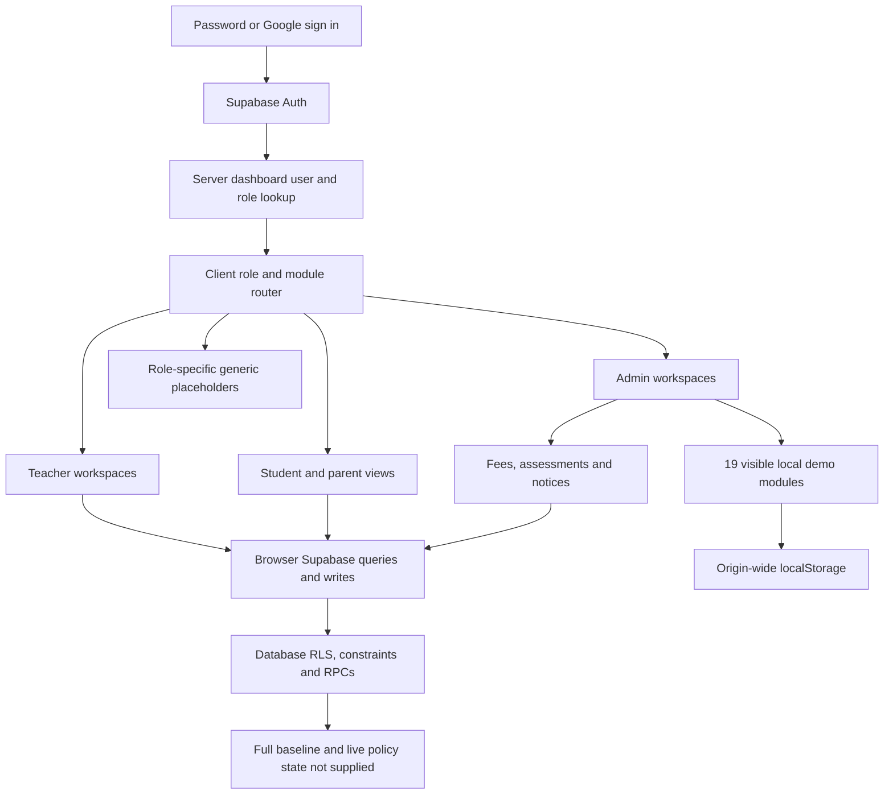

# Kids Corner: codebase audit and route to a paid school product

Audited 2 November 2026. Target confirmed by Shoaib: Delhi NCR private schools with 300–1,500 students. No interested school, customer interviews, agreed budget or paid pilot currently exists.

## Decision

**The current application is a teacher-oriented functional prototype with a broad admin demo. It is not ready to run a paying school's operations.** Preserve the useful code, fix its data risks, and complete one school workflow before expanding the menu.

The strongest existing product seed is teacher classwork/homework publishing with student/guardian views and absence-linked missed work. The most plausible first purchase proposition is reliable fee and office operations with migration and onboarding. Those are separate observations: the closest working feature is not automatically the easiest feature to sell.

“Next.js instead of PHP/WordPress” is not a defensible reason to buy. The language does not determine whether balances reconcile, parents receive information, or teachers can use the system. Existing ERP vendors already cover the proposed module list. A school must see a measurable reason to adopt or switch.

| Readiness area | Result |
|---|---|
| Source compilation | Typecheck and Webpack production build pass after clean install |
| Default build | Turbopack blocked by worker process/port permissions in this audit environment |
| Lint | Broken `next lint` script; no working lint configuration supplied |
| Authentication | Genuine Supabase Auth; server dashboard verifies authenticated user and roles |
| Admin operational modules | 19 of 25 visible links use local demo implementations; six use partial Supabase integrations |
| Teacher workflow | Real attendance, classwork/homework, assessments and profile paths; serious correctness/governance gaps |
| Parent/student experience | Seven academic read screens; attendance link is misrouted; nine other visible modules are placeholders |
| Money correctness | Unsafe invoice/payment posting; no complete reconciled fee lifecycle |
| Multi-school/family security | Cannot be certified from this source package; baseline schema and full policies are missing |
| Commercial validation | Unvalidated; research supports workflow relevance, not demand for this product |

## Audit scope and confidence

The actual app is nested at `/Users/shoaib/kids-corner-erp-frontend/kids-corner-erp-frontend`. Neither the outer workspace nor inner application contains a `.git` directory. There is no commit, branch, remote or change history to audit. Source hashes are recorded in [source-manifest.json](source-manifest.json).

Inspected all 43 files under `app`, `components`, `lib`, `types` and `supabase/migrations`: 11,055 lines, plus package/lock/configuration files, proxy and README. Dependencies, generated `.next` output and TypeScript build metadata were not treated as authored source. Only two incremental database migrations are supplied.

Three parallel reviews covered modules/workflows, authorization/data integrity, and market/customer economics. Critical findings were cross-checked against source. The architectural graph is an aid, not proof of behavior.

Evidence labels in this report:

- **Confirmed in source:** a control flow, storage mode or invariant is visible directly in code. Database outcomes still depend on deployed schema/policies.
- **Locally reproduced:** verified against an isolated build, with placeholder Supabase configuration.
- **Unverified deployment gate:** missing evidence; this does not establish a production vulnerability.
- **Product hypothesis:** a proposal requiring school observation or payment, not an established customer fact.

No production database was accessed or changed, no real account was used, and `.env.local` values were not read or copied. No application implementation was changed. Audit documents, graph artifacts and normal generated typecheck metadata are the only workspace outputs.

## What the system actually does

Most business logic and direct database access sit in large client components. The dynamic module route has 2,238 lines; `role-dashboard.tsx` has 1,776; `teacher-views.tsx` has 1,346. Attendance, finance totals, school context and assessment rules are duplicated and already disagree between screens. A service boundary and database invariants are needed; splitting files cosmetically would not fix that.

Supabase is a reasonable foundation. Rewriting into MERN, adding microservices, or building native apps does not address the current failures. Keep Next.js/TypeScript and Postgres/Supabase while making the backend reproducible and authoritative.

The detailed [module and role matrix](MODULES.md) covers every menu item. Useful distinctions:

- Admin `students`, `parents`, `teachers`, `admissions`, `attendance`, `academics`, `timetable`, operations, reports, audit logs and settings are local demos. Adding a student here does not provision the real student/enrollment consumed by teachers or finance.
- Admin fees/invoices/reports, exams/results and notices contain live queries/writes, but payment is preview-only in the admin finance screen. The accountant dashboard has a different, unsafe real payment write path.
- `/modules/academics` is a demo setup screen; `/modules/academic` is an older live subject setup screen with no explicit page-level admin role check. These routes do not share one authoritative setup workflow.
- Teacher homework/classwork and marks use Supabase. Attachments, student hand-in, homework completion and final parent report cards are not implemented workflows.
- Finance/reception module navigation generally reaches placeholders. Principal has a dashboard but not equivalent working management screens.
- Student/parent dashboards show some linked data; the presence of a navigation link does not mean a usable fee, receipt, result or notices module exists.

## Findings that block a paid deployment

P1 means fix before entering real school operational data. P2 means a material defect or release requirement. These priorities reflect expected business impact, not a claimed incident in production. Detailed evidence, qualifications and fixes are in [SECURITY.md](SECURITY.md) and [MODULES.md](MODULES.md).

| ID | Priority | Finding and impact | Source evidence |
|---|---|---|---|
| F01 | P1 | Teacher dashboard initializes empty attendance and defaults missing entries to Present. Reloading and saving can overwrite an existing absence; date changes reuse stale edit state. | `components/dashboard/role-dashboard.tsx:325,470–485,608–624` |
| F02 | P1 | Every payment creates a fresh full fee demand, then a payment in a separate request. Part payments do not settle one existing demand; failed/replayed requests can leave inconsistent money records. | `components/dashboard/role-dashboard.tsx:972–1018` |
| F03 | P1 | Academic save upserts a log, deletes activities, then inserts replacements. Failure after deletion can destroy existing homework; concurrent edits can interleave. | `lib/academic.ts:166–190` |
| F04 | P1 | Teachers can grant their own class/subject and class-teacher scope. Later attendance/assessment checks trust those assignments. Approval authority is assigned to the person receiving it. | `supabase/migrations/20261101_teacher_assessments_and_profile.sql:355–376`; module route `:579–597` |
| F05 | P1 | Visible admin core records are local demo state. A paid school cannot reliably admit/enroll/invite a child or configure live academic masters from them. Keys have no school/user scope and survive logout. | Module route `:168–216`; `lib/admin/admin-demo-service.ts:160–187` |
| F06 | P1 | Student/parent/principal attendance opens a teacher register that requires a teacher profile. Many other authorized-role menu items open placeholders. | Module route `:168–172,227–241,522–542` |
| F07 | P1 | Clearing a score leaves the old score stored; admin marks save also overwrites teacher remarks with null. Corrections can silently change or fail to change a pupil's record. | `components/admin/admin-assessment-workspace.tsx:266–293`; `components/teacher/teacher-views.tsx:454–495` |
| F08 | P1 gate | Base schema, complete RLS/grants, activation/registration RPCs, baseline seed and restore procedure are missing. Fresh deployment and family/tenant isolation cannot be proven. | Two incremental SQL files; `types/database.ts:1–3`; activation page RPC calls |
| F09 | P2 | Auth callback permits arbitrary absolute or protocol-relative `next` URLs. Local HTTP returned 307 to the supplied external origin without a code. | `app/(auth)/auth/callback/route.ts:2`; [route probes](route-probes.txt) |
| F10 | P2 | Class-log policies check own teacher identity but not complete school/year/class/subject scope. Supplied policies alone accept incoherent scope; missing constraints may mitigate it live. | `20261101_teacher_assessments_and_profile.sql:387–408` |
| F11 | P2 | Class-teacher unique indexes omit academic year, blocking retained assignment history across year rollover. | `20261030_academic_teacher_self_management.sql:24–30` |
| F12 | P2 | Assessment scope can change after marks exist; only teacher UI blocks it. Database rules do not preserve the class/year/subject enrollment invariant when the assessment moves. | Admin assessment `:326–336`; SQL `:56–78,208–239,264–278` |
| F13 | P2 | Marks/max-marks validation has a potential concurrent-update window; no common assessment row lock. This needs a two-session DB test. | `20261101_teacher_assessments_and_profile.sql:63–70,217–225` |
| F14 | P2 | Dashboard sums payment amounts without paid-status filtering; finance screen filters paid rows. Financial totals can disagree. | `role-dashboard.tsx:1414–1426`; admin finance `:174–194` |
| F15 | P2 | Finance/history queries are unpaginated or explicitly capped. Configured API row limits can silently truncate totals and history. | Admin finance `:108–113`; `lib/academic.ts:117–128`; teacher views `:1008` |
| F16 | P2 | Notice audience saves plural labels but edits/other values expect singular role identifiers. Recipient inbox/delivery workflow is absent. | `admin-notices-workspace.tsx:120–121,149–153` |
| F17 | P2 | Attendance percentage counts holidays in the denominator; approved leave and half-days have no explicit agreed policy. | `role-dashboard.tsx:1154–1155,1315–1316` |
| F18 | P2 | Rapid parent child switching can let an older asynchronous response overwrite the newly selected child's details. This is within linked children, not a demonstrated cross-family leak. | `role-dashboard.tsx:1276–1313` |
| F19 | P2 | UTC date slicing can select yesterday before 05:30 IST, including operational attendance/billing dates. School timezone is not authoritative. | `role-dashboard.tsx:194–195,988`; admin attendance `:11` |
| F20 | P2 | `npm run lint` invokes a non-working command; no tests/CI/configured regression suite is supplied. README is an old replacement-file instruction, not a deployment runbook. | `package.json:6–11`; `README.md` |

Clarifications that prevent overstating the audit:

- No confirmed cross-school production breach was demonstrated. The assessment helper does enforce the owner's teacher identity and same school. The self-assignment issue permits expanding same-school operational scope; it does not automatically expose another teacher's existing assessment.
- An admin assessment `FOR ALL` policy exists at SQL lines 290–294. Admin assessment creation is not classified as broken merely because the teacher INSERT policy is narrower.
- A public route shell returning 200 is not by itself an authentication bypass. The dashboard redirects anonymous requests; actual database access depends on RLS. Central server role/tenant guards are still needed for predictable routing.
- A successful typecheck/build and zero dependency advisories do not validate financial correctness, row security or production operation.

Secondary usability gaps: global search and Bell have no working action; icon-only controls lack accessible names; generic modals lack full dialog/focus behavior; login has no visible forgot-password link despite the route existing; invoice Print prints the whole app and downloads are JSON previews; school branding is hardcoded. Fix these after the data safety and role-flow blockers.

## Verification performed

The supplied `node_modules` was incomplete: no `.bin`, and `@supabase/ssr` could not resolve. Initial failures caused by that copy were not counted as source TypeScript defects. A separate copy at `/private/tmp/kids-corner-audit-20261102` was installed using the existing lockfile with lifecycle scripts disabled. The original dependency tree/package manifest were not repaired or upgraded.

| Check | Result | Limit |
|---|---|---|
| Clean locked dependency install | Pass, 69 packages installed | In temporary copy; no version upgrades |
| `npm run typecheck` | Pass | [Log](typecheck.log) |
| `npm run build` | Failed on process/port permission in Turbopack CSS worker | Reproduced after permission retry; [log](turbopack-build.log); not attributed to source syntax |
| `npm run build -- --webpack` | Pass, compile/type/static generation completed | Placeholder Supabase URL/key; [log](webpack-build.log) |
| `npm run lint` | Fail: treats `lint` as an invalid project directory | [Log](lint.log) |
| `npm audit --omit=dev --json` | Zero reported production advisories | Point-in-time advisory coverage only; [JSON](dependency-advisories.json) |
| HTTP probes | Login/reset/update render; anonymous dashboard 307 to login; callback open redirect reproduced | [Probe results](route-probes.txt) |
| Browser inspection | Login and reset page render; unnamed theme buttons visible in accessibility tree; recovery page has email/send link controls | No login/reset email submitted |
| Authenticated teacher/admin/parent CRUD | Not executed | No test accounts, complete local schema or safe seeded DB supplied |
| Two-school/two-family RLS, finance concurrency, restore | Not executed | Mandatory release gates, not inferred passes |

The architecture graph has 383 nodes, 621 edges and 27 communities: [interactive HTML](../../../graphify-out/graph.html), [report](../../../graphify-out/GRAPH_REPORT.md), [health notes](../../../graphify-out/GRAPH_HEALTH.txt). SQL AST parsing was unavailable; SQL was manually reviewed. Graph extraction reported 69 dangling-endpoint edges and 27 collapsed same-endpoint edges. Host-agent semantic token usage is unavailable. Do not use graph completeness or benchmark estimates as product/security evidence.

## Problems worth validating with schools

The following are research-informed hypotheses. No interviews have established their frequency, cost or willingness to pay in our target segment.

| Candidate problem | Buyer and operator | Proposed software response | Measure before building |
|---|---|---|---|
| Accountant cannot quickly explain paid/due balances | Owner; accountant | One student ledger, existing-demand payment allocation, concessions/reversals, receipt history and day closing | Minutes to trace one payment; disputed/unmatched items; closing time |
| Dues follow-up is manual and inconsistent | Owner; accountant/office | Accurate aging list, verified guardian contacts, targeted reminders and delivery log | Hours/week preparing and following lists; avoid treating affordability defaults as a messaging bug |
| Parents repeatedly ask for receipt/homework/attendance details | Principal; office and guardians | Mobile receipt/history access, scoped circulars, homework and acknowledgment | Actual weekly query categories, repeated calls, parent channel preference |
| Teachers do double entry or cannot trust attendance | Principal; teachers | Fast Android-friendly register, explicit unmarked state, calendar and auditable correction | Minutes/class; missing entries; double-entry time; connectivity behavior |
| Switching fails because data is messy and staff are untrained | Owner; accountant/admin | Previewed import, rejected-row report, signed opening balances, hands-on training and export | Sample old-system exports; import exceptions; staff training time; cutover owner |

A historical August 2024 ERP request from three Delhi Air Force schools explicitly requested Excel migration, staff training, attendance, category-based fees, online receipts and parent access to school information. It also specified SBI ePay, demonstrating that an existing bank arrangement can constrain payment integration. This is evidence that schools procure these workflows, not a live lead or validation of our specific 300–1,500-student proposition. Its large-vendor eligibility and on-site staffing requirements make that procurement tier unsuitable for a first solo-founder contract. [School-issued RFP, PDF page 8 and eligibility sections](https://c9.shauryasoft.com/media/bny-wcp-2408040702-1384242745-1.pdf).

## Competition and differentiation

| Existing option | Evidence checked | Implication |
|---|---|---|
| Fedena | Public web tiers list US$999/$1,399/$1,699 yearly, unlimited users, hosting, training, support and onboarding | Core ERP modules and onboarding are already marketed; these USD prices are not a negotiated India quote. [Official plans](https://fedena.com/pricing-and-plans) |
| Frappe Education | Open-source students, admissions, guardians, attendance, assessments, fees and portal | “Modern” and “open-source” are not sufficient differences. [Official documentation](https://docs.frappe.io/education/introduction) |
| Entab | Advertises fees, parent apps, WhatsApp/push, report cards, migration and training | These are vendor claims, not independently verified outcomes, and not unique features for us. [Entab One](https://www.entab.in/entab-one.html) |

Candidate advantage to test: one narrowly defined school-office workflow that is faster and more reliable for a reachable local school, with approved migration, usable mobile screens, a named support owner and clear export/exit. Prove it with that school's baseline; do not claim uniqueness or guaranteed revenue improvement.

The existing absence-linked homework view could become useful when it closes the full loop: absence recorded, catch-up work shown, guardian notified appropriately, student completion acknowledged. It is currently a feature seed; superiority over an incumbent is unproven.

Do not publish “CBSE ready”, “UP Board ready”, “secure” or “DPDP compliant” as validated guarantees based on the login screen or this audit. Obtain school-approved report-card/attendance/certificate requirements and test the relevant controls first.

## Full product architecture to build toward

Use one modular application and database, with explicit domains. This is the eventual complete product scope, not a promise to build every domain before the first invoice.

| Domain | Required capability and invariant |
|---|---|
| Platform and tenancy | School/branch, active school context, branding, subscription/entitlements, school lifecycle; platform operator distinct from school admin; all access denied outside verified memberships |
| Identity and people | Invitations, staff provisioning/revocation, student identity, multiple guardians and children, emergency contacts; relationships verified and historical |
| Academic masters | Years/terms/calendar/holidays, classes/sections/subjects, approved teacher scope, enrollment, promotion/transfer/withdrawal; history never overwritten to simulate rollover |
| Admissions | Inquiry, follow-up, application, approved documents and conversion into one real enrollment; no duplicate child on retry |
| Attendance and learning | Date/section register, correction approval, leave, school day rules; homework/classwork/material with publish, attachment and completion lifecycle |
| Finance | Fee heads/schedules/demands, concessions/late fees, payments and allocations, receipt sequence, reversals/refunds, settlement reconciliation and exports; ledger is authoritative |
| Assessment | School-approved grading, assessments, marks states, corrections/moderation, term totals and report-card publish/retract; only published child-scoped results reach guardians |
| Communication | Actual recipient records, class/role/guardian scope, in-app inbox, templates, outbox/retries, provider receipts and acknowledgments; “sent” and “delivered” are different |
| Operations | Timetable/substitutions, certificates/documents, library/stock/transport/HR, introduced when school demand supports their workflow cost |
| Trust and operation | Append-only business audit, monitoring, backups/restore, imports/exports, retention, support access and offboarding; service recovery demonstrated |

Implementation rules:

1. A request derives user, school membership and role from verified identity. A submitted `school_id` is not authorization. Make school context consistent across dashboard, module and RPC.
2. Every school-owned relation enforces tenant consistency using constraints and RLS. School/class/section/year/subject relationships must agree. Guardian access requires verified child linkage and appropriate publication state.
3. Keep simple authorized CRUD behind strict RLS; perform multi-record business actions in transactional SQL RPCs or server services. Never ship a service-role key to browsers.
4. Use an authoritative invoice/payment/allocation/reversal model with decimal-safe amounts (for example integer paise), stable idempotency keys, DB receipt sequences and locks. Separate billing periods from collection dates. Handle opening balances, refunds, waived fees and overpayments explicitly.
5. Store provider events in a deduplicated inbox. Verify signatures and amounts; process duplicate/out-of-order webhooks safely. The school owns its merchant settlement arrangement. A screenshot is not proof of settlement.
6. Store outgoing messages in a transactional outbox with attempts, delivery state and failure reason. Attendance edits must not accidentally trigger duplicate absence messages.
7. Use private object storage with tenant/child authorization and signed access for files. Record file metadata, purpose, access and deletion lifecycle; a document title is not an upload implementation.
8. Make critical forms validated on server/DB, not only through HTML inputs. Use generated Database types, explicit domain types and one definition for totals/statuses.
9. Define school timezone/calendar centrally. Unmarked is not present, an API failure is not zero, and absent is different from a holiday.
10. Keep tested import/export and operating documentation in version control. A frontend source folder without its base database cannot be the deployable product.

## Build sequence and acceptance gates

No fixed delivery date is credible before recovering the complete schema and observing a school workflow. Advance by acceptance gates.

| Stage | Build | Exit condition |
|---|---|---|
| 0: Preserve and reproduce | Establish Git, recover baseline migrations/RPC/policies, seed two schools/families, correct tooling and document setup | A fresh local DB and app boot reproducibly with no undocumented console setup |
| 1: Remove data hazards | F01–F04/F07, open redirect, assessment invariants, year/date rules and critical regression tests | Replays, failures, stale edits and concurrent writes preserve money and pupil records |
| 2: Real school setup | Replace demo people/academic masters with durable workflows, invitations, real enrollment/guardians and previewed import | One imported school can provision staff/parents and use consistent records across roles |
| 3: Paid fee/office pilot | Demands, allocation, receipts, adjustments/reversals, day closing, accurate dues and supported reminders | Accountant signs opening balances and daily reconciliation; owner pays for defined scope |
| 4: Daily adoption | Reliable attendance, notices inbox, homework/catch-up, mobile guardian receipt access | Staff independently uses the workflow; parent/teacher use is measured over an actual fee cycle |
| 5: Academic suite | Approved report cards, assessment publication, promotion, certificates and timetable | School signs generated outputs and year transition; permissions validated per role |
| 6: Repeatable expansion | Requested operations/integrations; platform billing and support tools for several schools | Multiple paying schools use substantially the same product without unsustainable custom work |

The implementation [backlog with testable acceptance criteria](BACKLOG.md) is the next engineering work queue. Building library, payroll, bus tracking, AI analytics and native apps now would increase scope before fixing the reasons a school cannot safely use the core.

## Paid pilot and business experiment

Start within the confirmed segment with one single-campus 300–600-student school, an accessible decision maker, a named accountant, usable records, and an upcoming fee cycle or vendor renewal. A well-adopted incumbent with no switching trigger is a poor first prospect.

**Pricing below is a proposed experiment, not market-validated willingness to pay or an offer already accepted by anyone.**

- An eight-week paid fee/office pilot at ₹10,000–₹20,000 (a ₹15,000 initial offer is one test). Include one approved import, two office users' training, a defined fee cycle and support hours. Freeze the scope in writing.
- Test ₹36,000–₹60,000/year up to 500 active students after successful acceptance. For 501–1,500, discover actual workload before quoting; ₹60,000–₹1.2 lakh/year is only a range to test.
- An illustrative regular plan is ₹48,000/year plus ₹15,000 onboarding. Credit or separate pilot/onboarding charges explicitly; do not accidentally double-charge for the same import.
- Define student counting, branches, support response hours, extra imports/training, school-specific changes and data export before sale. Quote payment/message consumption and custom integration separately.
- Use a short reconciliation/acceptance window with the existing process, then explicitly choose the authoritative system. Avoid indefinitely operating two unsynchronized fee ledgers.

Acceptance measures are targets requiring baseline measurement:

1. All imported opening balances, student/guardian mappings and exceptions signed off.
2. Every posted receipt reconciles to the ledger; duplicate requests/events produce zero duplicate postings.
3. Daily cash/bank/gateway reconciliation has an exception queue and named reviewer.
4. Aim for at least 30% less measured office time in the selected workflow, without promising that improvement before observation.
5. Staff independently creates a receipt, makes an approved correction, exports dues and closes a day.
6. Track adoption/support hours and guardian query volume. Track overdue cohorts, but do not attribute better collections to software without checking fee-cycle timing and policy changes.
7. A paid annual renewal, rather than praise for the demo, is the commercial outcome to seek.

Illustrative contribution economics at ₹4,000/month per school:

| Assumption | Two support hours/month | Eight support hours/month |
|---|---:|---:|
| Monthly subscription | ₹4,000 | ₹4,000 |
| Allocated infrastructure | ₹500 | ₹500 |
| Support at internal ₹300/hour | ₹600 | ₹2,400 |
| Contribution before other costs | ₹2,900 (72.5%) | ₹1,100 (27.5%) |

These are planning assumptions, not supplier quotes. Acquisition, travel, development, fixed payroll, tax, refunds and overhead are excluded. Ten schools at ₹48,000/year gives ₹4.8 lakh ARR, not ₹4.8 lakh profit. Repeated customization and support can destroy this model.

Gateway charges must be modeled separately. Razorpay's public education page advertises 2% excluding GST; at that rate, routing ₹5 lakh/month would cost ₹10,000 before GST. Negotiated rates and supported payment routes differ; get the school's own written arrangement. [Official education pricing](https://razorpay.com/solutions/education/), [pricing FAQ](https://razorpay.com/pricing/). Provider event retries/order also need backend handling. [Official webhook guidance](https://razorpay.com/docs/webhooks/validate-test/).

## Discovery plan before broad development

Interview 8–10 schools in the confirmed segment; observe at least three actual office workflows. Speak to both the decision maker and the daily operator. This is a proposed task, not outreach already done.

Ask to see an anonymized fee/receipt example, one dispute, a current dues list, an old-system export and the last day/month closing procedure. Record task duration, duplicate work, support failures, current annual spend, bank arrangements, connectivity and procurement timing.

Ask the school to choose its most expensive recurring problem and identify what it would stop doing if the product solved it. Ask who signs a paid pilot, who imports/checks balances and who trains staff. Do not collect real pupil records into this demo while validating demand.

Proceed when one school will pay for a bounded pilot and provides a named operator and data owner. Narrow/reconsider the proposition if repeated conversations show low urgency, no switching trigger, or service costs above the tested price. Do not respond to weak demand by adding more menu items.

## Child data, communication and operating requirements

These are product planning requirements, not a legal compliance opinion or certification.

- DPDP commencement is phased. The final November 2025 notification/rules phase substantive obligations toward May 2027; do not state that every provision is already effective on this audit date. The educational exceptions are conditional and limited, not a blanket school exemption. Applicable obligations and school/vendor responsibilities require checking the actual contract and workflow. [MeitY commencement notification](https://www.meity.gov.in/static/uploads/2025/11/c56ceae6c383460ca69577428d36828b.pdf), [final Rules](https://www.meity.gov.in/static/uploads/2025/11/53450e6e5dc0bfa85ebd78686cadad39.pdf).
- Prepare a data inventory, verified guardians, purpose/consent records where required, minimum collection, tenant/family permissions, retention/export/deletion, restricted support access, access logs and incident response. Do not use student data for unrelated AI training or marketing.
- Bulk SMS requires sender onboarding, principal-entity/header/content-template registration and the relevant identifiers; delivery attempts need provider state and failure handling. [TRAI sender guidance](https://www.trai.gov.in/advice-to-senders).
- WhatsApp/API onboarding, approved templates/consent and usage costs depend on the selected provider and message purpose. Verify them when a school chooses that channel; do not price unlimited messaging into the base plan.
- Choose recovery targets in the contract and demonstrate a restore before live use. Keep independent exports, monitor jobs/provider failures, and provide a documented offboarding export.

## Immediate recommendation

Recover and version the real database, fix attendance/payment/academic-save invariants, then replace demo school masters. In parallel, validate the fee/office proposition with school operators. Keep the full suite as a staged product direction; earn the first renewal with one reliable workflow.
